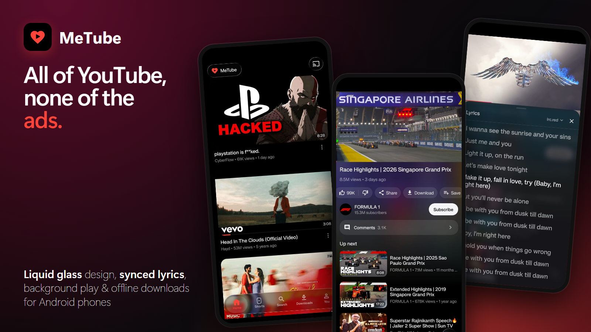

<p align="center"></p>

<h1 align="center">MeTube</h1>

<p align="center"></p>

**YouTube, the way it should feel.** No ads. No interruptions. A gorgeous liquid glass interface, synced lyrics, background play and one-tap downloads — all free and open source.

<p align="center">
  
  
  
  
  
</p>

<p align="center"><a href="https://github.com/yashoncode/metube/releases/latest"><b>⬇ Download the latest MeTube</b></a></p>

## Why people are switching

- 🚫 **Zero ads, zero sponsor segments.** Ads are gone, and SponsorBlock skips in-video sponsors, intros and "like and subscribe" reminders for you.
- 💎 **Liquid glass everywhere.** Frosted, lens-bending glass on the navigation bar, player buttons and Shorts — iOS 26 style, on Android.
- 🎤 **Synced lyrics.** Music videos get live, line-by-line lyrics that follow the song. Pick your favourite lyrics provider in one tap.
- 🎧 **Background play & picture-in-picture.** Lock your screen or switch apps — the music keeps going.
- ⬇️ **Offline downloads up to 1080p.** Save videos to watch on a flight, a train or with no data.
- 📱 **Shorts done right.** A clean, full-screen Shorts player with glass like, comment and share buttons.
- 🔄 **Always something new.** Pull Home to refresh and get videos you haven't seen yet.
- 💬 **Smooth comments & fullscreen.** A rounded glass comment bar that rises with the keyboard, and buttery vertical fullscreen.
- 👎 **Dislikes are back.** Return YouTube Dislike shows the real count. DeArrow swaps clickbait titles and thumbnails.
- 🔐 **Your account, your subscriptions.** Sign in with a code, or use it without an account. Cast to your TV.

MeTube is a fork of [NewTube](https://github.com/aleixrodriala/newtube) by [@aleixrodriala](https://github.com/aleixrodriala), which is built on [SmartTube](https://github.com/yuliskov/SmartTube) by [@yuliskov](https://github.com/yuliskov). MeTube is an independent project and is not endorsed by either upstream developer.

## Download

Get the APK for your phone from [Releases](https://github.com/yashoncode/metube/releases/latest):

| Your device | File |
|:--|:--|
| Most phones (64-bit) | `MeTube_<version>_arm64-v8a.apk` |
| Older phones (32-bit) | `MeTube_<version>_armeabi-v7a.apk` |
| Not sure | `MeTube_<version>_universal.apk` |

Android 7.0 or later. MeTube has its own app id (`io.github.yashoncode.metube`), so it installs alongside NewTube or SmartTube.

## What MeTube adds on top of NewTube

- **Floating glass.** The bottom navigation is a frosted glass capsule floating over the page. It shows a live, saturated blur of the content behind it with fine grain and a bright top rim. On Android 13 and later the edge also bends the content like a lens, with slight colour fringing. On Android 7 to 11, which can't sample what's behind a view, it shows a solid tint instead. The code is in `smarttubetv/src/stmobile/java/com/newtube/mobile/ui/common/GlassView.java`.
- **New look.** A dark page (`#0B0B0E`), a red accent (`#FF453A`), large tab titles, a brand row with the actions in a glass pill, 20dp-rounded thumbnails, and glass action pills and cards on the watch page.
- **Dark theme by default.** Light theme is still available in Settings.
- **Lyrics.** Synced lyrics panel with a choice of providers.
- **Branding.** MeTube name, app id and APK names. The in-app updater checks this repository's releases.

## Build

```
./gradlew :smarttubetv:assembleStmobileDebug     # debug, for testing
./gradlew :smarttubetv:assembleStmobileRelease   # release, signed with keystore.properties if present
# APKs: smarttubetv/build/outputs/renamed_apks/stmobile<Type>/MeTube_<version>_<abi>.apk
```

Clone with `--recurse-submodules`. The backend lives in the `MediaServiceCore` and `SharedModules` submodules (NewTube's forks). Add `-PemulatorAbi` to run on an x86_64 emulator. For upstream documentation, see [README.newtube.md](README.newtube.md) and [CLAUDE.md](CLAUDE.md).

## License

MIT, see [LICENSE](LICENSE). The original NewTube and SmartTube copyright notices are kept. See [THIRD_PARTY_NOTICES.md](THIRD_PARTY_NOTICES.md).
