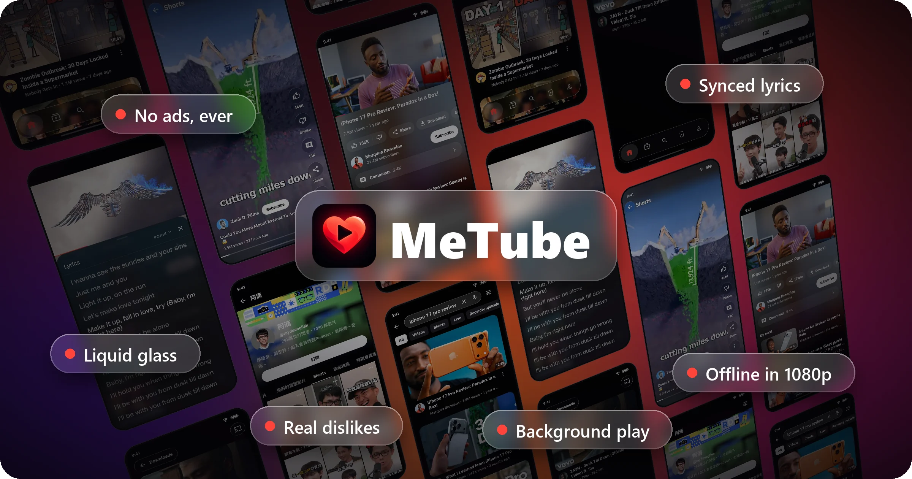

<p align="center"></p>

<h1 align="center">MeTube</h1>

**YouTube, reimagined. Different by design. Smooth by nature.** <br><br> No ads. No interruptions. Just a gorgeous liquid glass interface, synced lyrics, background playback, and one-tap downloads.<br><br> **A fresh way to experience YouTube.**<br><br>

<p align="center"></p>

<p align="center"><a href="https://github.com/Capricornus007/metube/releases/latest"><b>⬇ Download the latest MeTube</b></a></p>

## Features

<table>
<tr>
<td width="50%" valign="top">🚫 <b>No ads, no sponsors</b><br>Ads are gone, and SponsorBlock skips sponsors, intros and "like and subscribe" reminders.</td>
<td width="50%" valign="top">💎 <b>Liquid glass</b><br>Frosted, lens-bending glass on the tab bar, the player and Shorts.</td>
</tr>
<tr>
<td valign="top">🎤 <b>Synced lyrics</b><br>Music videos get live, line-by-line lyrics. Pick your lyrics provider in one tap.</td>
<td valign="top">🎧 <b>Background play and picture-in-picture</b><br>Lock the screen or switch apps and it keeps playing. Shorts float in their own portrait window.</td>
</tr>
<tr>
<td valign="top">⬇️ <b>Offline downloads</b><br>Save videos up to 1080p for a flight, a train or a day without data.</td>
<td valign="top">📱 <b>Shorts done right</b><br>A clean full-screen player with glass like, comment and share buttons.</td>
</tr>
<tr>
<td valign="top">🧑‍🎤 <b>Channels at a glance</b><br>Every card shows the channel's photo; tap it to open the channel with its banner, Subscribe button and Shorts tab.</td>
<td valign="top">🔎 <b>YouTube's search filters</b><br>One-tap chips for Videos, Shorts, Live and Recently uploaded, plus the full filter dialog.</td>
</tr>
<tr>
<td valign="top">👎 <b>Dislikes are back</b><br>Return YouTube Dislike shows the real count, and DeArrow swaps clickbait titles and thumbnails.</td>
<td valign="top">💬 <b>Smooth comments and fullscreen</b><br>A glass comment bar that rises with the keyboard, and vertical videos go fullscreen upright.</td>
</tr>
<tr>
<td valign="top">🎨 <b>Make it yours</b><br>Theme, app icon, glass, Home layout, tabs, double-tap skip time and the video menu, all on one page.</td>
<td valign="top">🔄 <b>Always something new</b><br>Pull Home to refresh and get videos you haven't seen yet.</td>
</tr>
<tr>
<td valign="top">🌏 <b>Speaks your language</b><br>English, Español, Română, Русский, 简体中文 and 繁體中文. Channel pages, view counts and dates follow your language too. <a href="TRANSLATING.md">Help translate</a>.</td>
<td valign="top">🔐 <b>Your account, your subscriptions</b><br>Sign in with a code, or use it without an account. Cast to your TV.</td>
</tr>
</table>

## Download

Get the APK for your phone from [Releases](https://github.com/Capricornus007/metube/releases/latest):

| Your device | File |
|:--|:--|
| Most phones (64-bit) | `MeTube_<version>_arm64-v8a.apk` |
| Older phones (32-bit) | `MeTube_<version>_armeabi-v7a.apk` |
| Not sure | `MeTube_<version>_universal.apk` |

Android 7.0 or later. MeTube has its own app id (`io.github.capricornus007.metube`), so it installs alongside NewTube or SmartTube.

## MeTube and NewTube

- **Floating glass.** The bottom navigation is a frosted glass capsule floating over the page. It shows a live, saturated blur of the content behind it with fine grain and a bright top rim. On Android 13 and later the edge also bends the content like a lens, with slight colour fringing. On Android 7 to 11, which can't sample what's behind a view, it shows a solid tint instead. The code is in `smarttubetv/src/stmobile/java/com/newtube/mobile/ui/common/GlassView.java`.
- **New look.** A dark page (`#0B0B0E`), a red accent (`#FF453A`), large tab titles, a brand row with the actions in a glass pill, 20dp-rounded thumbnails, and glass action pills and cards on the watch page.
- **Dark theme by default.** Light theme is still available in Settings.
- **Branding.** MeTube name, app id and APK names. Updates are installed by hand (download a new APK); the app no longer updates itself.

## Build

```
./gradlew :smarttubetv:assembleStmobileDebug     # debug, for testing
./gradlew :smarttubetv:assembleStmobileRelease   # release, signed with keystore.properties if present
# APKs: smarttubetv/build/outputs/renamed_apks/stmobile<Type>/MeTube_<version>_<abi>.apk
```

The glass is `smarttubetv/src/stmobile/java/com/newtube/mobile/ui/common/GlassView.java`; the README showcase comes from `python tools/render_showcase.py`. Clone with `--recurse-submodules`. The backend lives in the `MediaServiceCore` and `SharedModules` submodules (NewTube's forks). Add `-PemulatorAbi` to run on an x86_64 emulator. For upstream documentation, see [NewTube's README](https://github.com/aleixrodriala/newtube#readme) and [CLAUDE.md](CLAUDE.md).

## Support MeTube

MeTube is free, has no ads and always will. I build it in my spare time because I love using it.
If it makes your YouTube a little nicer and you'd like to say thanks, you can buy me a coffee.
It's completely optional, and every coffee is truly appreciated. ☕

<p align="center"><a href="https://buymeacoffee.com/yashwynth"></a></p>

A star on GitHub or sharing MeTube with a friend helps just as much. Thank you for using it! ❤️

## License

MIT, see [LICENSE](LICENSE). The original NewTube and SmartTube copyright notices are kept. See [THIRD_PARTY_NOTICES.md](THIRD_PARTY_NOTICES.md).
